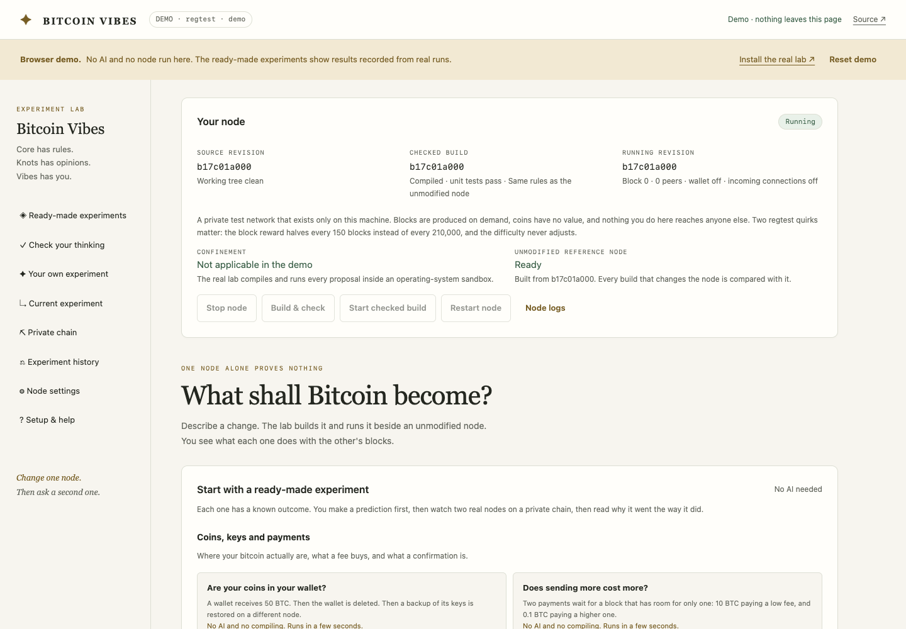
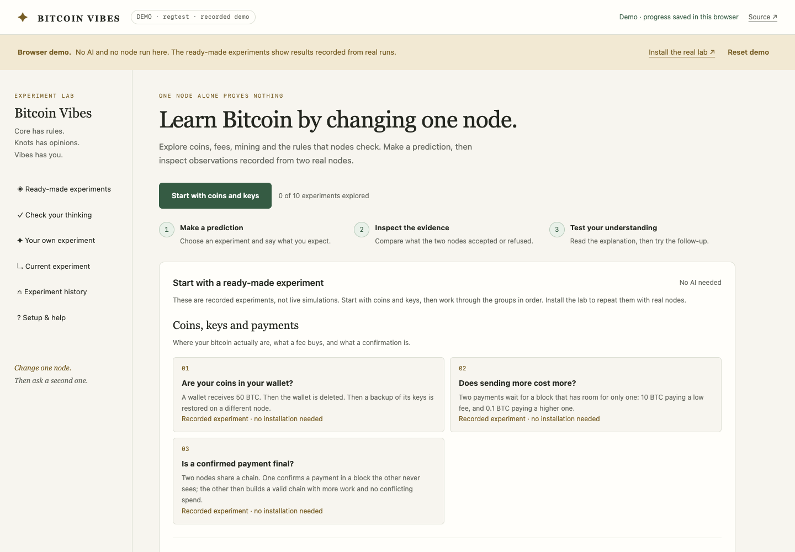
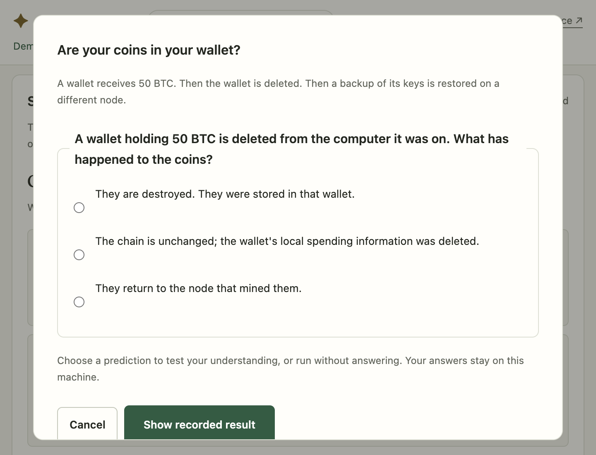
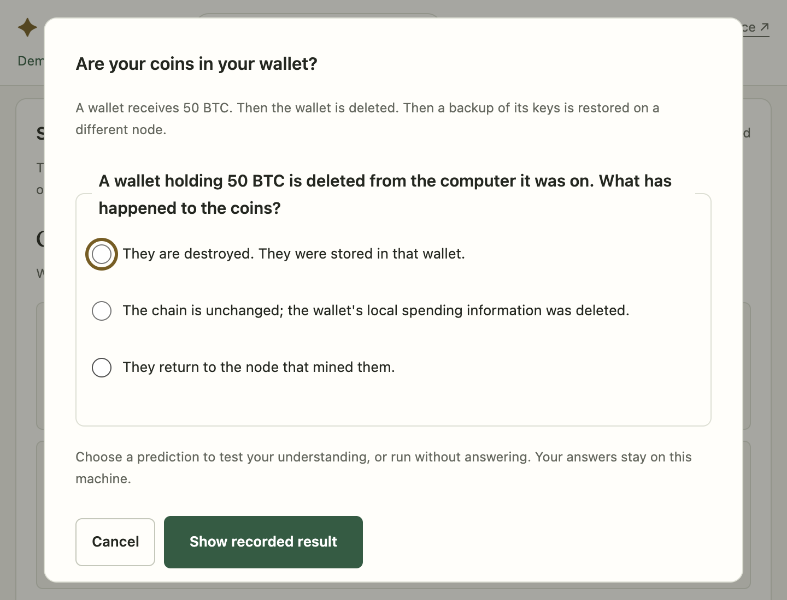

# Bitcoin Vibes release audit

Audited 31 October 2026 against `c0b7c1afa44756f5f05d73550194aa951d07d2d5`.
The scope is the teaching lab, browser demo, installer, packaging and their
verification. Bitcoin Core consensus source under `src/` is unchanged.

## Findings addressed

- Audited all ten lessons, ten questionnaire statements, predictions, follow-ups,
  comparison verdicts and matching documentation against primary references.
  [The content audit](vibes-content-audit.md) records each factual correction.
- Grade completed matching experiments from observations. Reject incomplete or
  unrelated jobs and invalid options; preserve first answers and prevent duplicate
  counts. Save questionnaire rounds atomically and version the whole questionnaire.
- Distinguish valid block observations, consensus rejections, incomplete validation
  and infrastructure failures. Mining-share answers come from actual active-chain
  membership; a controlled branch probe checks shorter-branch compatibility.
- Measure actual coinbase outputs instead of mistaking the scheduled subsidy for
  the amount a miner claimed. Remove unsupported finality and historical claims.
- Match Bitcoin Core configuration precedence, boolean/integer parsing, scoped
  options and the testnet3 chain alias. Preserve other networks when saving and
  exclude consensus overrides and external signer commands from ordinary settings.
- Put learning before node operations. Label every demo result as a replay, remove
  fake running-node status, expose a starting action and next experiment, and
  improve mobile navigation, keyboard focus, dialogs and reduced-motion behavior.
- Preserve unsaved questionnaire choices during polling, retry lost score writes,
  restore scored follow-ups reliably, prevent confirmation-dialog races and keep
  earlier demo records exportable. Show useful asset-loading and offline errors,
  and announce connection status only when it changes instead of on every poll.
- Require exact recorded slider inputs and matching, scoreable observations; refuse incomplete recordings, replace
  fixtures atomically, and preserve the distinction between unrun and passing tests.
- Reuse installed programs only when complete and attributable to clean matching
  source. Never stamp dirty or unreadable source as a release build. Remove stale
  CMake paths from container packages and establish the container reference from
  its initial source commit. Make container build concurrency configurable.
- Require a lab restart after source updates so cached lessons and scene scripts
  cannot silently continue on the new source. Keep stop and read-only operations
  available while preventing further mutations.
- Prevent the static-site output from overlapping its source tree. Add real HTTP
  browser coverage and retain the verified static site and real-node recordings
  as CI artifacts.

## Independent review

Separate agents reviewed the lessons, backend and interface. A second read-only
review covered the integrated configuration, recording and packaging changes.
It found additional quiz-migration, follow-up restoration, Core configuration,
recorder-reference, metadata-validation, CI-assertion and installer-provenance
defects; those findings were routed back to the owning implementation and fixed
with regressions. This is independent AI review advice, not human approval.

## Verification

The baseline Python suite ran 125 tests: 117 passed and eight optional
real-node checks were skipped. The original static browser workflow and axe audit also passed; those
checks did not catch the content and real-console defects above.

Verification completed during integration:

| Check | Result |
|---|---|
| Fresh Apple Silicon stock node, CLI and unit-test build | Passed |
| Full stock Bitcoin Core suite | 784 test cases passed |
| Three deliberately changed teaching-node builds | Passed |
| Integrated app suite against real regtest nodes | 138 tests passed, no skips (integration snapshot) |
| Final local app suite | 174 total: 166 passed and eight optional real-node checks skipped |
| Stock validation suite and changed subsidy variants | Stock passes; doubled/halved subsidy produce expected stock-test findings; earlier regtest halving is not exercised by this suite |
| Real authenticated console in Chrome | Review, discard, apply, reload, history, mobile and offline controls pass |
| Expanded axe audit | Zero detected violations in four states at 1440, 390 and 320 pixels, with fresh fixtures |
| Static browser workflow | Passed with fresh fixtures: predictions, follow-ups, reloads, scoring retries, imports, modal focus, missing assets and narrow screens |
| Exact replay/scoring contracts | All 26 recordings, including all 17 slider settings, passed |
| Initial Linux node job | Core build/unit tests, real-node app suite (156 tests, no skips), sandbox, changed-node experiments and all 26 recordings passed |
| Docker image build and unprivileged startup | Passed on Linux CI at `100d9062ed`; stronger provenance/restart checks run on the final branch |
| Packaging and recorder regressions | Six packaging checks and twelve recording/reference checks pass |
| Source/diff checks | Python and JavaScript parse; no whitespace errors; no `src/` changes |

See [PR #13](https://github.com/hotpixelgroup/bitcoin/pull/13) for the final
branch checks, exact commit, run links and generated recording/site artifacts.
The table above distinguishes completed local checks and integration snapshots
from those final branch checks.

The host antivirus classified temporary Bitcoin node executables as CoinMiner
and removed them during a recording run. The recorder rejected that run and
preserved the previous fixtures. No antivirus settings were changed. Final
recording verification was completed by the isolated Linux CI job. The
recording archive SHA-256 was checked before adoption; every case also passed
the current recorder's exact-input and scoreable-observation validation. The local
Docker build also stalled with its daemon unresponsive; no existing user
containers were stopped or reset.

## Interface evidence

| Before | After |
|---|---|
|  |  |

[Updated mobile layout](vibes-audit-images/after-mobile.png) and
[recorded experiment evidence](vibes-audit-images/experiment-result.png). The starting
action is visible before the explanation on narrow screens.

## Form-layout and downloadable-release follow-up

On 1 November 2026, a visual report exposed a defect that the earlier axe
audit did not detect: native radio inputs inherited text-field padding and a
44-pixel minimum height. Their visible centers sat 17 CSS pixels below the
answer's first line. Native radios and checkboxes now have their own sizing;
their labels provide the larger click target. Wrapped legends, narrow settings
rows, dialog scrolling and WebKit keyboard focus received matching fixes.

The new regression measures all ten prediction forms, follow-ups, questionnaire
radios, preferences, the compile option and boolean settings in Chromium and
WebKit. Across six viewport/density cases, 1,116 control layouts passed with a
maximum first-line offset of 0.72 pixels. The enlarged cases model
200%-equivalent reflow with half the CSS viewport and twice the output density;
they do not automate browser zoom controls. Label clicks, keyboard operation,
visible focus, the existing browser workflow and twelve axe audits also pass.
The expanded local Python suite ran 187 tests: 179 passed and eight optional
real-node checks were skipped.

| Before | After |
|---|---|
|  |  |

Release verification now checks the complete 15-file asset set, checksums,
platform headers, source and patch provenance before publication. The Mac
bundle records its release number and exact source; a new launcher explains
when an existing lab uses different source while preserving its experiments.
Packaged node/CLI builds disable optional multiprocess IPC to avoid depending
on the builder's Cap'n Proto/KJ shared libraries. Fresh-runner jobs then fetch
the public release's installer and programs on all three supported platforms,
verify provenance, start the installed console and private node, and exercise
the three changed-node experiments. The Mac job also inspects the DMG read-only.
The previous Mac programs declared a macOS 15 minimum while their launcher
declared 12. The prepared Mac release now consistently requires Apple silicon
and macOS 15 or later. Its build uses the Apple SDK's SQLite, and every archived
Mac program must declare the documented minimum and load only system libraries.
Regression fixtures reject Homebrew library/search paths and mismatched minima.
See the release workflow for the publication and public-download results.

## Deployment

The current public site uses the `gh-pages` branch at `/`. This PR does not
merge itself, publish a release or change Pages settings. CI builds the complete
site into the `bitcoin-vibes-site` artifact, including `.nojekyll`, for review
and deployment from the approved commit.

To inspect a local build:

```sh
python3 contrib/vibes/build_site.py --out /tmp/vibes-site
python3 -m http.server 21880 --bind 127.0.0.1 --directory /tmp/vibes-site
```

The test README documents all commands. The Linux node job produces a separate
`bitcoin-vibes-recorded-demo` artifact by exercising every supported demo input
through the real console API with freshly built stock and changed nodes.

A paid live AI session, Mac notarisation and real-mainnet operation are outside
these verification results. The lab remains a teaching environment; a finite
comparison does not establish arbitrary modified code is safe.
